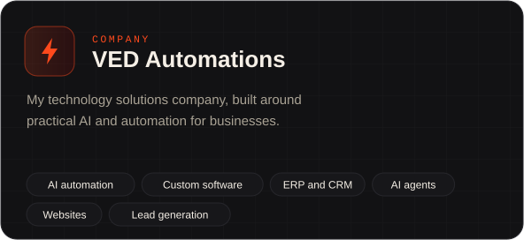
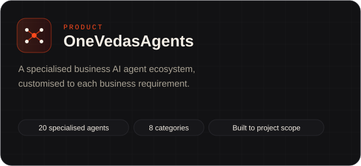
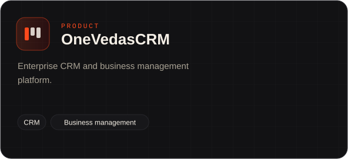
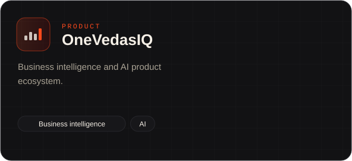
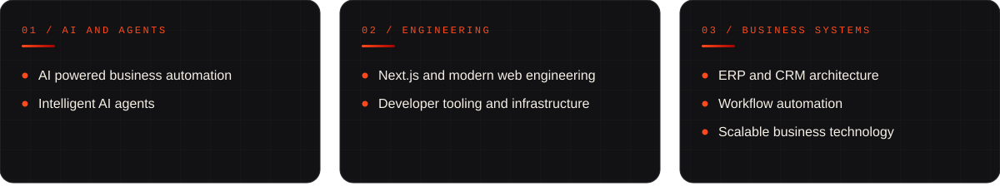

 

I'm Vignesh, an entrepreneur from Chennai. I like turning messy, manual work into systems that run properly. Today that is **VED Automations**, where we help businesses use AI and automation to capture leads, follow up faster and stop losing time on repetitive tasks.

My work sits where technology, automation and business strategy meet. I'm interested in AI agents, CRM and ERP architecture, and software that a growing business can scale on. I build, I test, and I keep improving what already works.

 

<table>
<tr>
<td width="50%"></td>
<td width="50%"></td>
</tr>
<tr>
<td width="50%"></td>
<td width="50%"></td>
</tr>
</table>

 

 

 

 

<a href="https://www.linkedin.com/in/vigneshsankaranofficial">LinkedIn</a>
&nbsp;&nbsp;·&nbsp;&nbsp;
<a href="https://www.instagram.com/vigneshsankaran/">Instagram</a>
&nbsp;&nbsp;·&nbsp;&nbsp;
<a href="https://vigneshsankaran.com">vigneshsankaran.com</a>
&nbsp;&nbsp;·&nbsp;&nbsp;
<a href="https://vedautomations.com">vedautomations.com</a>

