## About

I'm Vignesh, an entrepreneur from Chennai. I started building businesses because I like turning messy, manual work into systems that run properly. Today that is VED Automations, where we help businesses use AI and automation to capture leads, follow up faster and stop losing time on repetitive tasks.

My work sits where technology, automation and business strategy meet. I'm interested in AI agents, CRM and ERP architecture, and software that a growing business can actually scale on. I build, I test, and I keep improving what's already working.

## What I'm building

<table>
<tr>
<td width="50%" valign="top">

### VED Automations
My technology solutions company, built around practical AI and automation for businesses.

* AI automation
* Custom software
* ERP and CRM solutions
* AI agent implementations
* Website development
* Lead generation systems

[vedautomations.com](https://vedautomations.com)

</td>
<td width="50%" valign="top">

### OneVedasAgents
A specialised business AI agent ecosystem.

* 20 specialised agents
* 8 categories
* Customised to each business requirement
* Integrations and capabilities developed according to project scope

</td>
</tr>
<tr>
<td width="50%" valign="top">

### OneVedasCRM
Enterprise CRM and business management platform.

</td>
<td width="50%" valign="top">

### OneVedasIQ
Business intelligence and AI product ecosystem.

</td>
</tr>
</table>

## Tech stack

**Hands on development**

**Automation and AI**

<b>Platforms, infrastructure and integrations</b>

 

I work with these as part of delivering projects. They are not all used in every project.

**Websites and CMS**

**Infrastructure and deployment**

**CRM and business systems**

**Analytics and SEO**

**Payments**

## GitHub activity

## Currently exploring

<table>
<tr>
<td width="33%" valign="top">

**AI and agents**

AI powered business automation and intelligent AI agents.

</td>
<td width="33%" valign="top">

**Engineering**

Next.js and modern web engineering, plus developer tooling and infrastructure.

</td>
<td width="33%" valign="top">

**Business systems**

ERP and CRM architecture, workflow automation and scalable business technology.

</td>
</tr>
</table>

## Let's work together

If you run a business and want to automate lead generation, follow ups, CRM or internal workflows, I'd like to hear about it. I'm also open to conversations with other builders and founders working on AI and automation.

Vignesh Sankaran · Chennai, India · Founder, VED Automations

